# 幕间 · Mise-en-scène

> 骰子落下之前，故事尚有另一种可能。

**一个双层的 LLM 情节推演框架。** 世界层在镜头之外运行：区域、势力、事实、在路上的消息和事件驱动的纪元。聚焦剧场里，人物只依据自己知道的事做决定；每个举动分成 **deed（做了什么）** 与 **effect（想达成什么）**，用 d20 + 能力/特质/状态判定 effect 是否落地；敌意举动会触发被指向者的回应。

不是“让 AI 续写小说”。世界层留下可审计的事件束、资源变化与知识传播；聚焦层留下 deed/effect、回应、骰点与后果。时间由事件推动，记忆会进入下一轮判断。**视角、人称、文体、有限视角与主角，不塞进推演，而由推演之后的文字创作工作流处理。**

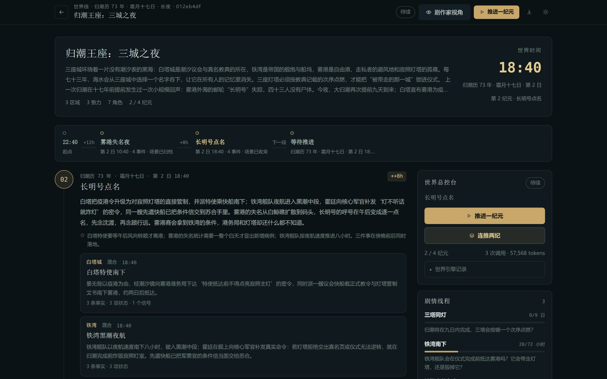

```text
世界导演
  → 纪元：时间推进 + 2–3 个事件束（可带父子事件）
  → 事实 / 资源 / 势力 / 线程 / 带延迟的信号
  → 从事件里生出一个聚焦场景
  → 所有主动角色同时秘密宣告 deed / effect
  → 导演为每个 effect 裁定 DC
  → 敌意举动指向的主动角色选择回应 / 是否继续原举动
  → d20 检定与对抗分级
  → 导演收束场面、状态与时间跳跃
  → 场景余波写回世界账本
```

---

## 快速开始

需要 **Node.js 24+**（原生执行 TypeScript，无需构建）和 pnpm。

```bash
pnpm install
cp .env.example .env
# 编辑 .env，填入当前提供方的 API KEY（DeepSeek 或 MiniMax）
pnpm start
```

打开 <http://127.0.0.1:4386>。

`.env`：

```dotenv
# 当前使用哪个提供方：deepseek | minimax
LLM_PROVIDER=minimax

# DeepSeek（OpenAI 兼容）
DEEPSEEK_BASE_URL=https://api.deepseek.com
DEEPSEEK_API_KEY=sk-...
DEEPSEEK_MODEL=deepseek-flash

# MiniMax（Anthropic 兼容；/v1/messages）
MINIMAX_BASE_URL=https://api.minimax.cn/anthropic
MINIMAX_API_KEY=sk-...
MINIMAX_MODEL=MiniMax-M3.1-Flash
MINIMAX_EFFORT=max

# DeepSeek 用：auto | enabled | disabled
# auto = 导演开推理，角色快速行动
LLM_THINKING=auto
# effort=max 的单次调用可能很长
LLM_TIMEOUT_MS=600000
PORT=4386
HOST=127.0.0.1
```

CLI 可以在不修改 `.env` 的情况下切换模型：

```bash
node src/cli.ts --scenario fog-harbor --beats 1 \
  --provider minimax --model MiniMax-M3.1-Flash --effort max
node src/cli.ts --scenario fog-harbor --beats 1 \
  --provider deepseek --model deepseek-flash
```

MiniMax 没有 `thinking: true/false`，只有 `output_config.effort` 的 `low | medium | high | xhigh | max` 挡位；本项目的 `MINIMAX_EFFORT` 默认 `max`。它用 Anthropic 兼容的 `/v1/messages`，不使用 OpenAI 的 `response_format`，JSON 由提示词约束 + 解析器容错。

### 第一次使用

1. 打开「新建推演」，选择预置剧本《雾港：最后一盏灯》直接开局（首页也可以从「继续推演」接着上一次玩）。
2. 在推演页点击「推进一刻」。一次完整的时刻会调用导演与所有角色，通常需要 30–90 秒。
3. 页面会实时轮询推演进度；完成后展示公开叙事、每个人的效果与回应、状态变化、时间推进。
4. 点击角色卡打开档案，查看能力、特质、状态、记忆、关系与秘密（秘密默认模糊，点击揭示）。
5. 右上角「剧作家视角」显示内心、私密线索和导演幕后注。
6. 点击「连推三刻」可以连续推进；达到剧本上限后仍可单步继续。

想从更大的尺度开始，点击导航栏的「世界线」，进入**世界导演台**：

1. 用预置世界《归潮王座：三城之夜》建立一条世界线，或展开「高级」粘贴自己的世界 JSON。
2. 点击「推进一纪元」。世界导演会给出时间推进、区域/势力事件、事实与延迟信号；通常需要 1–2 分钟。
3. 在时间线上打开事件档案，或点击角色/势力查看他们各自知道的版本。
4. 纪元会给一个「聚焦场景」候选。点击「开镜」会生成一个使用原有角色引擎的局部 run；在局部场景里正常推演，之后点击「收束场景」把余波写回世界。
5. 右侧「世界导演台」可以推进一个/两个纪元或请求暂停；世界达到预设上限后可继续单步。

所有数据按**故事项目**保存在 `data/projects/` 下：一个世界项目是一个文件夹（`project.json` 清单 + `world.json` + 它的全部聚焦场景），独立推演是一个短篇项目。可以随时关闭服务，之后继续；整个项目文件夹可以直接复制、备份或删除。

> 旧版本的数据（`data/runs/` + `data/worlds/`）仍会被正常读取。要迁移到项目布局，停止服务后运行 `node src/cli.ts --migrate-projects`；旧文件会改名备份为 `data/legacy-<时间戳>/`，不会删除。

---

## 它实现了什么

| 需求 | 实现 |
|---|---|
| **按时刻推进** | 每个时刻是一个完整因果单元：取景 → 宣告 → 裁定 → 回应 → 掷骰 → 收束 |
| **时间不定长、由事件驱动** | 导演在收束时给出 `elapsed_minutes` / `label` / `reason`，时钟据此推进；可跨午夜 |
| **每人只拿自己可知的信息** | 公开处境 + 每人独立私密线索；举动提示词不含他人秘密、导演真相或他人内心 |
| **deed / effect + 点数** | 六项能力（1–10）+ d20 + 特质 + 状态 + 导演情境修正；deed 通常发生，检定决定 effect |
| **意外奏效 / 落地 / 落空** | 自然 20 或 margin ≥ +10 为意外奏效；margin ≥ 0 落地；否则落空（effect 没落地，但 deed 仍发生） |
| **敌意举动触发回应** | 只有强迫/伤害/夺取/欺骗类举动进入回应；目标可选择继续原举动（原举动与回应 −2，多人施压再叠加）或放下原举动（取消，回应正常） |
| **导演外部事件也要检定** | 天气/班次/机械/第三方等非角色引起的客观变化，只能在裁定阶段提出；每场最多 2 条，d20 对 DC 8/13/18，成功才写入公开事实，失败不写。收束不能新增这类原因 |
| **世界时钟** | 可写 `deadlineClock` / `deadlineFact`；到点且没有新的延迟公开事实时，写入“船已离岸”这类世界事实。它只关闭选项，不规定人物赶上、错过还是不走 |
| **结尾选择** | 推演不预设结局；文字工作流的大纲选择 `endingBeatIndex`，正文只用选中的时刻及之前材料，后面的时刻是未采用的延续 |
| **导演 LLM** | 开场取景与裁定拥有完整秘密；收束叙事被降权为外部视角，只拿公开因果，负责公开叙事、状态、事实与时间跳跃 |
| **性格、记忆、能力** | 角色卡 + 初始记忆 + 每刻新增主观记忆 + 秘密 + 关系 + 特质；能力值进入检定，也影响提示词中的举动方式 |
| **可复盘** | 每个举动保留 deed/effect、d20、能力值、特质、状态、修正、DC/回应总值、margin、结果；seed 保证机械层重试不重掷 |
| **世界纪元** | 世界层有自己的时间、区域资源、势力、线程、事实账本与场景契约；一次推进是一个不定长的纪元 |
| **事件因果** | 同一时刻可以有多个独立事件束；父子事件联合裁决，独立事件的写集冲突会被规则层拒绝 |
| **知识延迟** | 事实有 `knownBy`，消息是带 `delay_minutes` 的信号；势力知道不等于每个角色知道 |
| **多尺度** | 世界导演不替聚光角色做重大决定；把镜头交给原有角色引擎，再用“收束场景”把余波写回世界 |

局部规则：[`docs/RULES.md`](docs/RULES.md)  
世界模型：[`docs/WORLD.md`](docs/WORLD.md)  
文字创作：[`docs/PROSE.md`](docs/PROSE.md)  
收束测试：[`docs/CONVERGENCE-TEST.md`](docs/CONVERGENCE-TEST.md)  
类型实验：[`docs/GENRE-EXPERIMENT.md`](docs/GENRE-EXPERIMENT.md)

---


## 世界层

世界层不是“更大的一个场景”，而是**时间、因果、信息和调度**。

```text
区域 / 势力 / 角色 / 线程 / 资源         事实账本 + knownBy
                 │                              │
                 └──────── 世界导演 ────────────┘
                              │
                    纪元事件束（可带父子）
                    ┌─────────┴─────────┐
                    ▼                   ▼
              独立事件 A           信号：延迟抵达
                    │                   │
                    └─────────┬─────────┘
                              ▼
                        聚焦场景契约
                              │
                    原有角色引擎（局部 run）
                              │
                        收束回世界账本
```

### 世界账本

- 世界开始时写入区域、势力、具名角色、剧情线程与初始事实。
- 每次推进由一个 LLM 导演提出 `advance_minutes`、事件、事实、状态变化与信号；规则层校验后再写入。
- 时间不按固定轮次走。预置世界第一次推进了 12 小时，第二次推进了 8 小时；理由会写进时间线。
- 势力资源、区域控制、关系态度、角色位置/状态/条件、线程压力钟都被持久化。
- 世界页头部下方是**时间线总览**：起点 → 每个纪元的时间、事件数、讯息数与场景状态 → 当前/等待推进；点击节点跳到下方对应纪元的完整事件线。

### 并发与因果

世界导演每纪元可以给 2–3 个顶层事件束。跨区域的共同行动可以组织成父/子事件；不属于同一棵树的事件，如果写同一个区域/势力/角色/线程字段，解析器会拒绝并让导演重试。

这不是假装 LLM 会完美并发，而是把“什么算同一件事”变成可检查的写集约束。

### 认知不是真相

```ts
fact = "铁湾舰队已离港"
knownBy = ["iron_command", "huo_ting"]   // 只有这些实体知道
```

- `Signal` 带 `delay_minutes`，抵达前不会改变接收者的知识；
- 纪元推进跨过 `arrivesAt` 时，信号送达，相关事实才加入目标 `knownBy`；
- 势力级认知不会自动落到每个成员；
- 点击角色/势力能看到“已知/未知”，而不是只看到一个全知旁白。

### 聚焦场景桥

世界事件可以长出一个场景契约：同区域 2–4 名角色、一个尚未回答的问题、公开处境、私密线索。点击“开镜”会创建普通局部 `Run`：

- 角色已知的世界事实进入各自的记忆；
- 共同事实进入公开事实；
- 局部 GM 仍然不能拿到世界最终真相；
- 玩完（或至少完成一刻）后，可以把场景摘要与“聚焦余波”写回世界，作为新事实与新事件。

世界时间不会因为局部场景内的“一刻”自动推进；场景是对已发生事件的局部展开。

| 世界库 | 事件档案 |
|---|---|
| 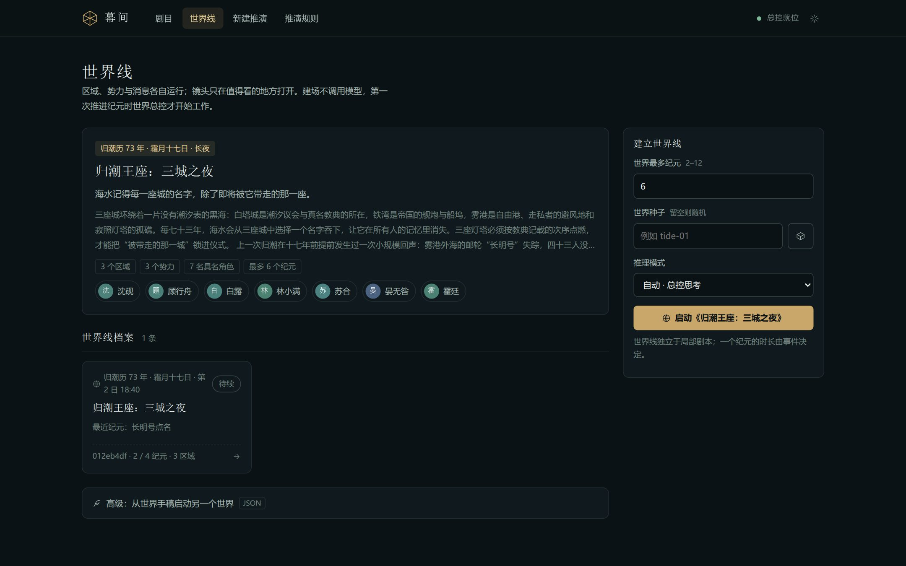 | 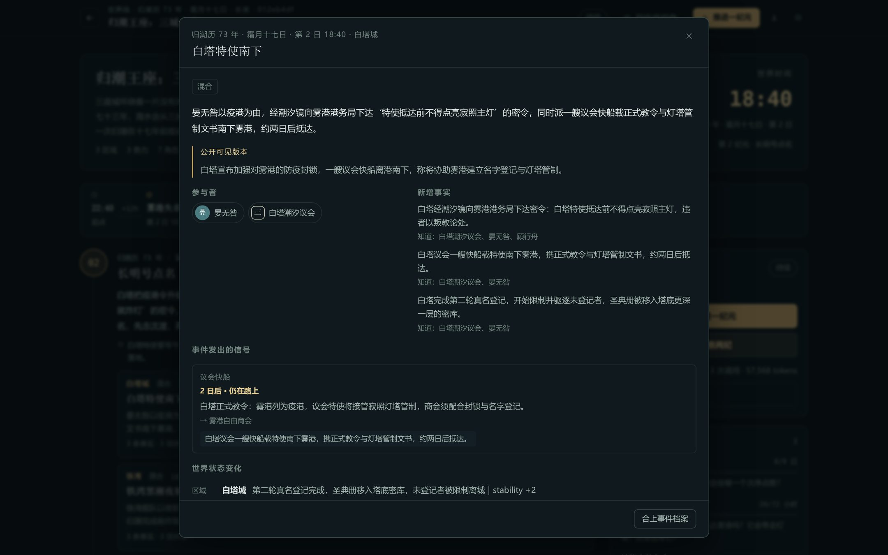 |

| 世界角色认知 | 聚焦场景 |
|---|---|
| 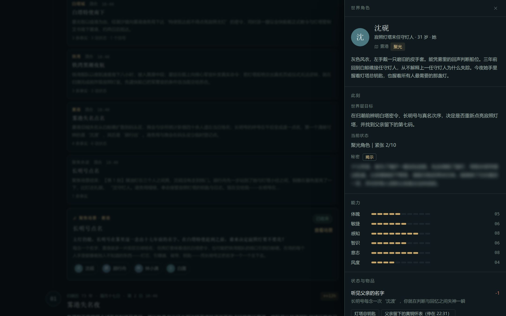 | 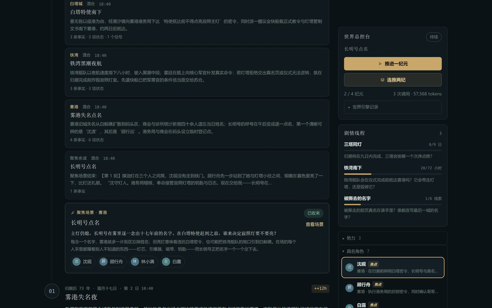 |

## 界面

首页是**项目总览**：有几个故事、各自进展如何、今天从哪个继续，一屏读完。世界项目卡给出纪元进度、开放线程、在途消息、最近动态与聚焦场景行；待收束的场景会有徽标提醒。进入推演后，舞台只显示公开叙事、deed/effect 与台词；骰式、DC、状态修正收进每条举动的「机制」折叠，「剧作家视角」才揭示幕后。

- **首页 · 项目总览**：统计行（世界项目 / 短篇 / 待办）+ 世界项目卡（场景行直达推演页）+ 短篇组 + 已归档折叠区，新建入口常驻。
- **项目卡操作**：一键归档 / 恢复；删除世界项目时明示将级联删除的聚焦场景数。
- **舞台**：时刻切换、公开叙事、紧凑举动账本（deed/effect + 结果章）、回应、余波、时间跳跃；机制默认折叠。
- **世界页 · 场景带**：聚焦场景按「推演中 → 待收束 → 可开镜 → 已收束 → 旧纪元契约」分区，开镜 / 收束就地操作；有待收束场景时头部下出现提醒条。
- **线程档案抽屉**：问题、赌注、压力钟与紧张、逐纪元演变笔记、关联事件、涉及势力 / 区域。
- **侧栏**：导演台（实时进度与推进按钮）、剧情线程（点击开档案）、势力 / 角色 / 在途消息 / 事实折叠。
- **档案抽屉**：性格、欲望、恐惧、秘密（默认遮蔽）、特质、记忆、关系、物品。
- **新建推演**：预置剧本或自定义 JSON 手稿。
- **双主题**：暗色（默认）与亮色（暖纸墨水），顶栏一键切换并记忆。

前端是零构建的原生 HTML/CSS/ESM：`public/js` 按 state / api / dom / logic / render 拆成 ES Modules，轮询按区域签名更新（未变化的区域不重写 DOM）；没有 npm 运行时依赖。设计决策见 [`docs/FRONTEND-REDESIGN.md`](docs/FRONTEND-REDESIGN.md)。

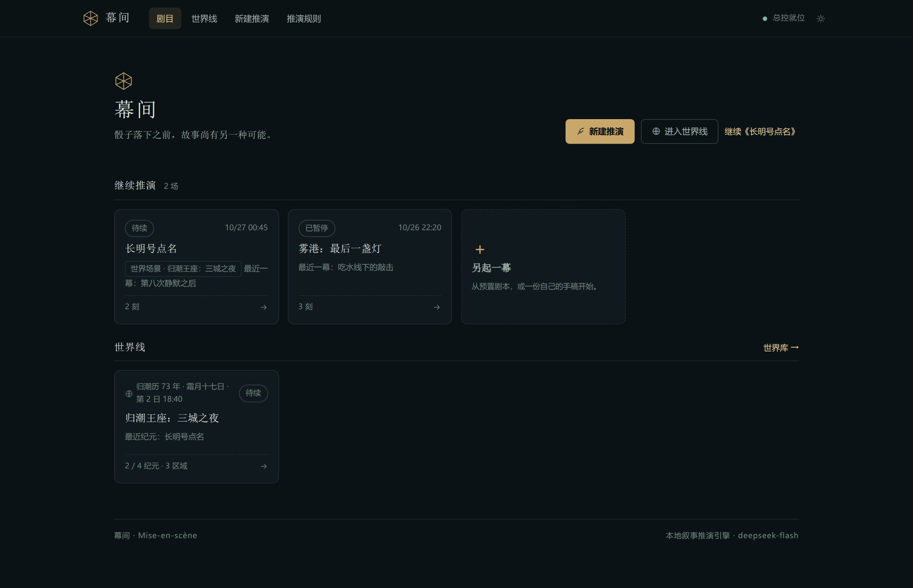

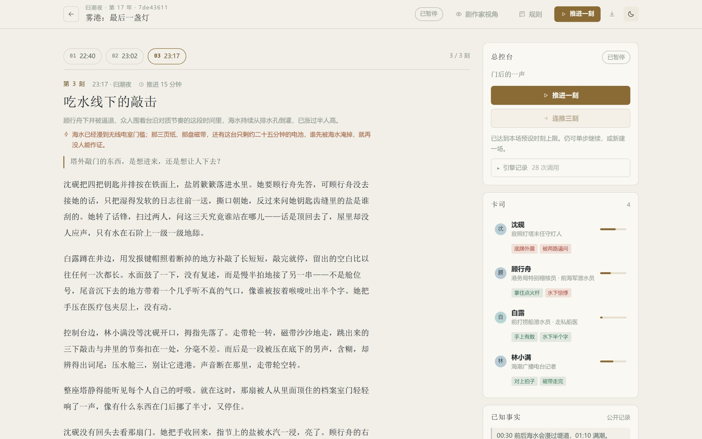

完整世界线的长截图见 [`docs/screenshots/world-dashboard.jpg`](docs/screenshots/world-dashboard.jpg)。

---

## 用命令行跑一场

适合做批量实验、回归测试或把剧本跑成可读战报。

```bash
# 跑《雾港》两刻，导出 Markdown 战报
node src/cli.ts --scenario fog-harbor --beats 2 \
  --seed harbor-01 \
  --out-md examples/harbor.md

# 继续一个断开的 run
node src/cli.ts --resume run_xxxxxxxx --beats 1

# 推演结束后，按指定 POV / 人称 / 文体写正文
node src/cli.ts --resume run_xxxxxxxx --prose-only \
  --pov chen_jianyue --person first \
  --style '克制、具体的家庭现实主义' \
  --prose-length medium \
  --prose-out story.md

# 把旧布局数据（data/runs + data/worlds）迁移到项目布局（需先停止服务）
node src/cli.ts --migrate-projects
```

常用参数：

```text
--scenario, -s   预置 id（默认 fog-harbor）
--beats, -b      本轮连续推演时刻数
--maxBeats       本场总幕数上限
--seed           固定种子
--thinking       auto | enabled | disabled
--provider       deepseek | minimax
--model          模型名
--effort         low | medium | high | xhigh | max（MiniMax）
--out-json       另存 run JSON
--out-md         输出 Markdown 战报
--prose-out      推演结束后跑文字创作工作流并输出正文
--prose-only     配合 --resume：不推演，只写正文
--pov            视角角色 id，或 omniscient
--person         first | third
--style          文体提示
--prose-length   short | medium | long
--resume         从已有 run 继续
--migrate-projects  迁移到项目布局（幂等；旧目录改名备份，不删除）
```

CLI 和 Web 使用同一引擎、同一规则、同一持久化目录。

---

## 自定义世界观

一份手稿就是一份 JSON：

```json
{
  "title": "晚潮公馆",
  "kicker": "暴雨夜 · 第三次守灵",
  "world": {
    "setting": "世界规则、历史、不可违背的事实",
    "location": "所有人所在的封闭场景",
    "premise": "开场冲突",
    "opening": "开场描写",
    "hiddenCanon": "只有导演知道的真相（可选）",
    "initialFacts": ["公开事实"],
    "startClock": "23:10"
  },
  "characters": [
    {
      "id": "lin_shu",
      "name": "林述",
      "title": "管家",
      "personality": "礼貌、周到，用服务别人的动作掩住判断。",
      "desire": "确认自己属于这个家。",
      "fear": "发现自己守的是别人的谎言。",
      "secret": "他偷走了遗嘱副本。",
      "abilities": { "physique": 5, "agility": 6, "perception": 8, "intellect": 6, "will": 7, "presence": 5 },
      "traits": [{ "name": "听见门响", "description": "凭声音判断哪扇门被开过。", "bonus": 2, "ability": "perception" }],
      "possessions": ["二楼钥匙"],
      "memories": ["昨晚书房里传出摔杯声。"],
      "relationships": []
    }
  ]
}
```

至少两位角色，最多六位；每个角色有 1–10 的六项能力、可机械生效的特质、初始记忆、秘密与关系。完整字段、限制与写作建议见 [`docs/SCENARIO.md`](docs/SCENARIO.md)。

在 UI 的「新建推演 → 自定义手稿」里可直接编辑 JSON、载入预置底本、导入文件、检查结构。

---

## 项目结构

```text
src/
  engine/           run 初始化、编排、状态、文件持久化
  rules/            d20 检定、对抗、多任务惩罚、结果分级
  world/            世界定义、时钟、纪元引擎、场景桥、世界持久化
  projects/         项目布局：清单、runId 索引、迁移
  llm/              DeepSeek/MiniMax JSON 客户端、局部提示词、世界提示词与校验
  prose/            推演之后的文字创作工作流（大纲 → 正文）
  render/           局部战报、世界战报
  server.ts         无框架 HTTP + 后台任务
  cli.ts            命令行
content/scenarios/  预置剧本
content/worlds/     预置世界
public/             原生前端（ESM 模块 + 双主题 CSS，无构建）
tests/              规则、编排、信息隔离、手稿、世界、项目存储与迁移
docs/               规则、架构、世界模型、手稿格式、文字创作
data/projects/      故事项目（gitignore）：世界项目 = project.json + world.json + runs/；短篇 = project.json + run.json
```

> 旧布局的 `data/runs/`、`data/worlds/` 在迁移前仍被双读；`node src/cli.ts --migrate-projects` 之后会改名备份为 `data/legacy-<时间戳>/`。

系统调用数：一次局部时刻 = 开场 1 + 角色举动 N + 裁定 1 + 敌意回应 T + 收束 1 = **N + T + 3**。角色举动与回应并行，默认并发 4。`--prose-out` 另加 2 次文字创作调用；正文工作流会输出所选 `endingBeatIndex`。  
一次世界纪元 = **世界导演 1 次**（含重试）；一个被收束的聚焦场景再走一遍局部调用。

更细的调用顺序、信息隔离矩阵、断点与 API：[`docs/ARCHITECTURE.md`](docs/ARCHITECTURE.md)

---

## 验证

```bash
pnpm test          # 规则 / 编排 / 信息隔离 / 手稿 / 正文工作流 / 时钟 / JSON 容错 / 世界 / 项目存储与迁移，43 项
pnpm test:ui       # 无头渲染冒烟：全部视图 + 场景带分区 + 线程抽屉 + 归档区
pnpm typecheck     # TypeScript 类型检查
```

自动化测试使用一个 deterministic 的假 LLM 模型，完整走完：

`取景 → 三个角色举动 → 裁定 → 敌意回应 → 掷骰 → 放下原举动 → 收束 → 状态/记忆/时间推进`。

信息隔离测试还会断言：角色举动提示词不包含他人秘密与导演真相；收束叙事提示词不包含任何秘密、内心、私密线索或 hiddenCanon；声明的台词则必须保留。

世界测试另外覆盖：初始事实与即时潮汐镜、延迟信号的抵达、冗余/纯内容信号、父子事件写入、独立事件写集冲突拒绝、`knownBy` 的知识隔离，以及“世界事实 → 局部角色记忆”的桥接。

### 实测记录（重构前）

> 以下战报记录的是这次重构之前的行为：那时还有 `trpg/drama` 两种提示词、`大成功/平和失败` 的旧标签，以及“目标行动必触发反应”的规则。当前的 deed/effect、敌意回应、被动角色与文字创作工作流见上文和 [`docs/RULES.md`](docs/RULES.md)、[`docs/PROSE.md`](docs/PROSE.md)。

**主场景 · 《雾港：最后一盏灯》**

- run：`run_7de4361132db`（seed `tide-final-public-01`）
- 模型：`deepseek-flash`，thinking 模式 `auto`（导演思考，角色快速行动）
- 3 个时刻，28 次 LLM 调用，134,380 tokens（reasoning 15,007），1 次自动重试
- 总耗时约 3 分 31 秒
- 时间跳跃分别为 **22 / 15 / 8 分钟**，全部由事件给出理由
- 3 个时刻共 12 条行动，6 次反应；同一角色同时面对 3 个来袭时，反应承受 `−2 多任务 + −2 围攻 = −4`
- 包含自然 20 大成功、自然 1 仍凭总分成功、平和失败、角色互相指向、公开事实累积
- 战报：[`examples/fog-harbor-demo.md`](examples/fog-harbor-demo.md) · run 快照：[`examples/fog-harbor-demo.json`](examples/fog-harbor-demo.json)
- Web 端完整走通点击推进 → 轮询进度 → 完成后渲染；无 console/page error；桌面与移动端截图在 [`docs/screenshots/`](docs/screenshots/)

**专项场景 · 放弃原行动**

为了验证“目标放弃原行动后，反应恢复正常”，另跑了一场两角色自定义场景《末班车：第七码》：

- 7 次调用，18,087 tokens
- 阿禾被骆青抓住手腕；她**放弃**原行动，原行动标记为 `abandoned`，反应惩罚 `0`
- 骆青选择继续原行动，承受 `−2`
- 场景手稿：[`examples/abandonment-test-scenario.json`](examples/abandonment-test-scenario.json)
- 单刻战报：[`examples/abandonment-test.md`](examples/abandonment-test.md)

主场景停在第三刻的预设上限，未强制收束；在 UI 里仍可继续单步推进。


**世界线 · 《归潮王座：三城之夜》**

- world：`world_012eb4df7754`（seed `three-tides-final-01`），2 / 4 个纪元
- 世界导演：3 次调用，57,568 tokens（reasoning 19,457），1 次自动重试；两个纪元约 2 分 45 秒
- 时间跳跃分别为 **720 / 480 分钟**，都由事件链给出理由
- 9 个世界事件：7 个生成的顶层/子事件 + 1 个延迟信号抵达 + 1 个聚焦场景余波
  - 第一纪元：一个跨白塔/雾港的父事件 + 两个子事件 + 一个独立的铁湾事件；
  - 第二纪元：白塔、铁湾、雾港三个独立事件同时发生；
  - 5 条信号中 4 条已送达，1 条仍在路上；事实账本 32 条
- 从第二纪元开镜《长明号点名》：`run_08fd0b79254e`，4 名角色，1 刻，9 次调用，49,892 tokens
  - 8 分钟时间跳跃，由点名后的僵持给出
  - 沈砚被顾行舟、林小满、白露三人同时指向；她选择继续原行动，反应承受 `−2 多任务 + −2 围攻 = −4`
  - 场景结束后已收束回世界：新增一条参与者事实、一个 `scene` 事件和“场景已收束”状态
- 世界战报：[`examples/three-tides-world.md`](examples/three-tides-world.md) · 世界快照：[`examples/three-tides-world.json`](examples/three-tides-world.json)
- 聚焦场景战报：[`examples/three-tides-focus-scene.md`](examples/three-tides-focus-scene.md) · 场景快照：[`examples/three-tides-focus-scene.json`](examples/three-tides-focus-scene.json)

### 类型实验：离开冒险/副本叙事（重构后已统一）

为了验证这套框架是否只能跑同一种故事，做了 **7 个非冒险类型 + DeepSeek/MiniMax 跨模型**（家庭现实主义、爱情双人戏、日常群像、后台讽刺喜剧、日轻奇幻、玄幻网文，以及被动角色场景《守夜》）。早期 `trpg/drama` 两种模式的 A/B 已经移除：现在只有一套“deed/effect + 点数 + 敌意回应”的推演规则。

- 推演层能写出可读的家庭戏、爱情戏、日常群像、喜剧、日轻和网文；被动角色场景也成立。
- 不再有 `trpg/drama` 两种模式；`deed/effect` 拆分、只有敌意举动触发回应、状态可见性、被动角色与机制折叠都已进入主引擎。
- MiniMax-M3.1-Flash 走 Anthropic 兼容接口；`effort=max` 适合开场/举动/裁定/回应，但 resolution 可能把预算全花在 thinking 上而不返回正文——实测中《晚饭》在 16k/32k 上限下都遇到空正文，换 `effort=high` 后 89–123 秒完成。CLI 用 `--provider minimax|deepseek` 切换。
- 推演之后，可用 `--prose-only --prose-out` 跑两步文字创作工作流（大纲 → 正文），按 POV/人称/文体生成短篇；见 [`docs/PROSE.md`](docs/PROSE.md)。
- 完整数据、文本证据、机制诊断与改法：[`docs/GENRE-EXPERIMENT.md`](docs/GENRE-EXPERIMENT.md)；战报：[`examples/genre-tests/`](examples/genre-tests/)。

### 界面

| 首页 | 一次检定 |
|---|---|
|  | 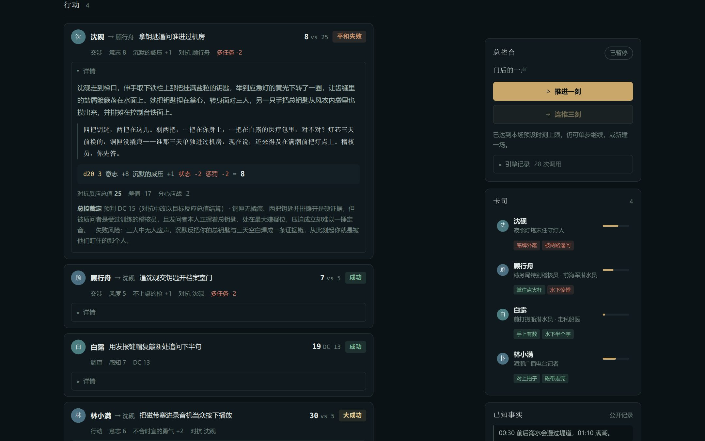 |

| 角色档案（秘密默认遮蔽） | 剧作家视角 |
|---|---|
| 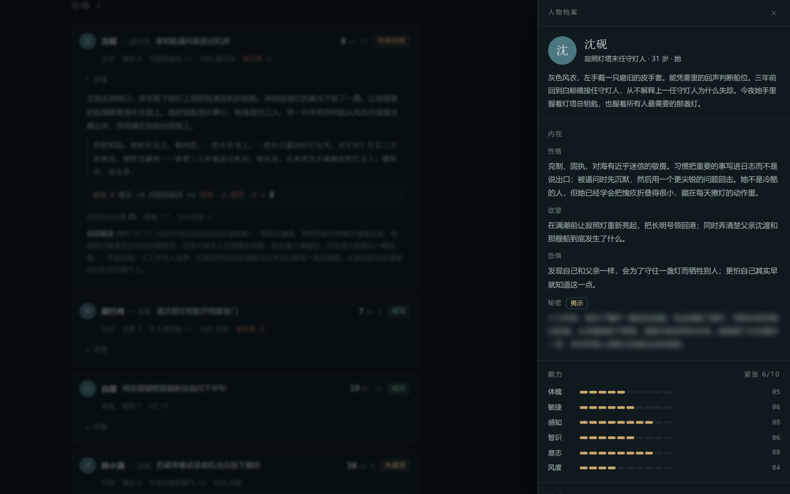 | 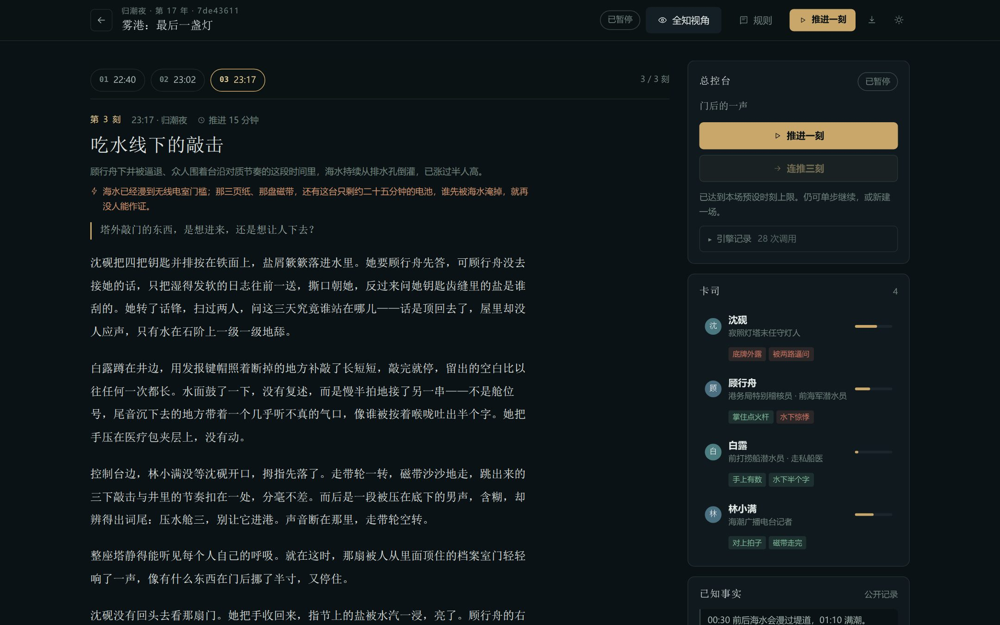 |

| 世界线 · 桌面 | 世界线 · 移动端 |
|---|---|
|  | 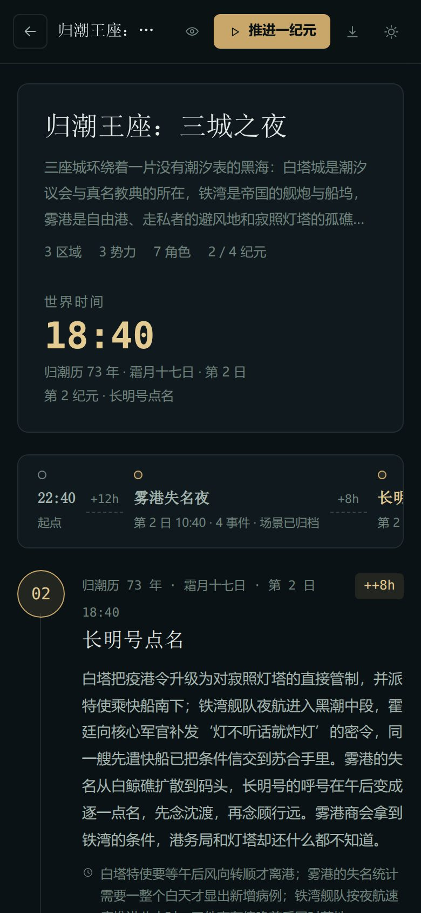 |

---

## 边界与设计选择

- **一个局部 run 仍是一个封闭的一场景故事。** 跨地点、分头行动由世界层组织；局部场景内的所有角色在可感知彼此的范围内活动。
- **世界层是“作者驱动 + LLM 提议”的。** 区域经济、战争与生态过程还没有独立的自动模拟器；目前由世界导演给出变化，规则层校验写入。
- **真假信念还未分层。** 当前事实账本记录“真实事实 + 谁知道”；谣言、误信和故意欺骗还没有成为一等对象。
- **交通耗时进入提示词，但还没有强制寻路器。** 世界导演可以写错时间/路线；目前依赖校验与重试，而不是图搜索。
- **聚焦场景的余波是“软回写”。** 它会把场景摘要、参与者事实和新事件写回世界；不会自动把局部骰点换算成区域资源或势力数值。下一步可以把收束结果做成结构化 effect。
- **难度由导演在宣告后给出。** 这是叙事导演的临场裁定，不是静态规则表。严格可复现的只有 seed、举动、骰点与机械结果；叙事本身仍然是生成的。
- **状态是具名条件，紧张值不直接改骰。** 情绪压力是上下文；要影响检定必须落成具体的 condition。
- **落空不是无事发生。** 它意味着 effect 没有落地，并留下代价、暴露、时间压力或新的错误信息，而不是灾难。deed 仍然发生。
- **结局不是机械收束。** `ending` 仍是 resolution 的可选输出；没有幕形、没有最终刻，也没有 `endingCondition`。世界时钟会阻止“23:55 后船还停在渡口”这类事实矛盾；故事可以在事后由文字工作流选择 `endingBeatIndex` 收束。双人单截止时间场景的实测与边界见 [`docs/CONVERGENCE-TEST.md`](docs/CONVERGENCE-TEST.md)。
- **秘密是分层的。** 开场导演与难度裁定拥有完整秘密；角色只拿自己的信息；收束叙事调用被结构性限制在外部视角，拿不到角色秘密、内心或隐藏真相。这从权限上阻止旁白替角色坦白，也意味着收官文字写的是公开发生的事，而不是全知解释。
- **叙事仍有自由发挥。** 机械结果严格来自角色宣告与骰点，但公开叙事模型可能补充舞台动作、氛围或对已声明意图的转述。信息隔离测试保证它拿不到秘密与内心，不能保证每一句散文都逐字对应宣告。对白的最可靠来源始终是行动记录本身。
- 适合本地单人创作与实验；服务没有身份认证，不要直接暴露到公网。

---

## API 速览

```text
POST /api/runs                   创建 run（presetId 或 scenario）
GET  /api/runs/:id               读取 run（含 active 状态）
POST /api/runs/:id/advance       启动后台推演 { mode: "one"|"auto", beats }
POST /api/runs/:id/stop          本刻结束后暂停
POST /api/runs/:id/prose         文字创作工作流（POV/人称/文体）
GET  /api/runs/:id/export.md     中文战报

GET  /api/world-presets          预置世界摘要
POST /api/worlds                 创建世界 {presetId 或 world}
GET  /api/worlds/:id             读取世界（含 active 状态）
POST /api/worlds/:id/advance     启动世界纪元 {mode, epochs}
POST /api/worlds/:id/stop        本纪元结束后暂停
POST /api/worlds/:id/scenes      从 hook 开镜 {hookId}
POST /api/worlds/:id/scenes/:run/seal  收束场景回世界
GET  /api/worlds/:id/export.md   世界战报
```

完整列表见 [`docs/ARCHITECTURE.md`](docs/ARCHITECTURE.md)。

---

**幕间 / MISE-EN-SCÈNE**  
MAKE A CHOICE. KEEP THE CONSEQUENCE.
